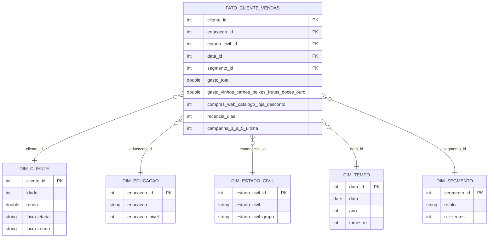

# MVP — Clusterização de clientes e estratégia comercial

**Aluno:** Marina del Giudice Chaves · **Matrícula:** 231025360
**Disciplina:** MVP — Engenharia de Produção / UnB · Prof. André Luiz Marques Serrano
**Plataforma:** Databricks Free Edition (Delta Lake, arquitetura medalhão) · **Dados:** Kaggle — Customer Personality Analysis

## 1. Objetivo
**Problema:** a empresa trata a base de clientes de forma homogênea.
**Hipótese:** existem segmentos naturais com valor, comportamento e resposta a campanhas diferentes; priorizar o orçamento comercial por segmento aumenta o retorno.

**Perguntas de negócio**
1. **P1.** Quantos segmentos naturais de clientes existem (K-Means sobre RFM + perfil demográfico) e qual o perfil de cada um em renda, composição familiar, gasto e frequência?
2. **P2.** Qual a contribuição de cada segmento para a receita total e o gasto médio por cliente? Que fração dos clientes concentra 80% do gasto (Pareto)?
3. **P3.** Como os segmentos diferem em mix de categorias (vinhos, carnes, peixes, frutas, doces, ouro) e em canal (loja, web, catálogo)? Qual o papel das visitas web e das compras com desconto?
4. **P4.** Qual a taxa de aceitação das campanhas (1 a 5 e a última) por segmento? Sob a premissa declarada custo por contato = Z_CostContact e receita por aceite = Z_Revenue, qual segmento tem melhor retorno estimado? (O significado de Z_* é uma premissa: a base não o documenta.)
5. **P5.** Quais clientes têm alto gasto histórico e recência alta (risco de inatividade) e que ação de retenção/reativação faz sentido para eles?

**Entrega de negócio:** playbook comercial com uma ação por segmento (oferta, canal, prioridade).

## 2. Dados
- **Fonte:** https://www.kaggle.com/datasets/imakash3011/customer-personality-analysis · **Licença:** CC0: Public Domain (conferida em AAAA-MM-DD)
- **Coleta:** 2026-10-21T17:30:01+00:00 (UTC) · 2240 linhas × 29 colunas · 220188 bytes · sha256 `cd0affa36b1b981e80ba0e27767e9b3ab723f7a3dba948f722af81abc6b990ea`
- **Formato original:** CSV separado por TAB. Metadados em `catalogo/metadados_coleta.json`.

## 3. Arquitetura e metodologia
Fluxo: **Kaggle → Volume (Unity Catalog) → Bronze → Silver → Gold → Análise**, orquestrado por um Job do Databricks (Bronze → Silver → Gold → Análise).

| Camada | Notebook | Tabelas Delta |
|---|---|---|
| Bronze | `notebooks/01_bronze_ingestao.py` | `bronze_marketing_campaign` |
| Silver | `notebooks/02_silver_limpeza_features.py` | `silver_clientes`, `silver_regras_negocio`, `silver_constantes` |
| Gold | `notebooks/03_gold_estrela_cluster.py` | `fato_cliente_vendas`, `dim_cliente`, `dim_educacao`, `dim_estado_civil`, `dim_tempo`, `dim_segmento`, `gold_clusterizacao_*`, `gold_premissas_p4` + visões `vw_*` |
| Análise | `notebooks/04_analise_p1_p5.py` | usa as visões `vw_*` |

**Modelo:** esquema estrela (grão: um cliente). Catálogo de dados em `catalogo/catalogo_dados.md` (e `.csv`) e diagrama em `catalogo/diagrama_estrela.png`.




**Qualidade de dados** (tabela completa em `catalogo/qualidade_por_atributo.csv` e `catalogo/qualidade_testes.csv`): nulos em `Income` (24), outlier de renda (666.666), anos de nascimento implausíveis (< 1900), categorias estranhas em `Marital_Status` (Alone/Absurd/YOLO), `2n Cycle` em `Education`, colunas constantes `Z_*`. Regras de tratamento R1–R10 em `catalogo/regras_transformacao.csv`. Evidência: `evidencias/qualidade_outliers_categorias.png`.

**Clusterização:** K-Means (padronização z-score; variáveis: recência, compras totais, log do gasto, renda, idade, nº de filhos). `k` escolhido pelo maior silhouette com k ≥ 3 (cotovelo como apoio); estabilidade avaliada com 5 sementes (ARI). Parâmetros: seed=42, k de 2 a 8.

## 4. Resultados
> Complete com os números reais após rodar o notebook `04_analise_p1_p5` (um parágrafo por pergunta, referenciando a evidência).

- **P1:** [preencher] — evidência: `evidencias/p1_cotovelo_silhouette.png`, `evidencias/p1_perfil_segmentos.png`
- **P2:** [preencher] — `evidencias/p2_receita_pareto.png`
- **P3:** [preencher] — `evidencias/p3_mix_canal.png`
- **P4:** [preencher] (premissa Z_*) — `evidencias/p4_campanhas_roi.png`
- **P5:** [preencher] — `evidencias/p5_clientes_risco.png`
- **Discussão geral e playbook comercial:** [preencher]

## 5. Ética e LGPD
Licença CC0 (a conferir), sem identificadores diretos, `ID` sequencial; risco de reidentificação medido por k-anonimato (`catalogo/risco_reidentificacao.csv`); uso de faixas em vez de valores exatos nas dimensões analíticas.

## 6. Autoavaliação
[preencher: copie a seção 12 do notebook do Colab com suas respostas]

## 7. Como reproduzir
1. Abra `notebooks/colab_mvp_unb.ipynb` no Google Colab e execute todas as células (coleta, qualidade, catálogo, geração dos notebooks Databricks).
2. No Databricks Free Edition: importe os `.py` de `notebooks/`, envie `marketing_campaign.csv` para o Volume `workspace.mvp_marketing.raw` e execute 01 → 02 → 03 → 04 (ou o Job).
3. Confira as tabelas em *Catalog* e preencha os resultados neste README.

## 8. Estrutura do repositório
```
README.md
LICENSE
/notebooks   (01..04 Databricks + notebook do Colab)
/scripts     (mvp_core.py)
/catalogo    (catalogo_dados.csv/.md, diagrama, qualidade, regras, metadados)
/evidencias  (prints e vídeos da execução na nuvem)
```
