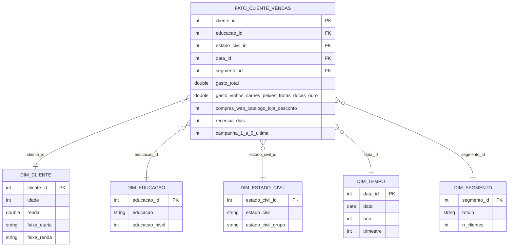

# MVP — Clusterização de clientes e estratégia comercial

**Aluno:** Marina del Giudice Chaves · **Matrícula:** 231025360
**Disciplina:** MVP — Engenharia de Produção / UnB · Prof. André Luiz Marques Serrano
**Plataforma:** Databricks Free Edition (Delta Lake, arquitetura medalhão) · **Dados:** Kaggle — Customer Personality Analysis

## 1. Objetivo
**Problema:** a empresa trata a base de clientes de forma homogênea.
**Hipótese:** existem segmentos naturais com valor, comportamento e resposta a campanhas diferentes; priorizar o orçamento comercial por segmento aumenta o retorno.

**Perguntas de negócio**
1. **P1.** Quantos segmentos naturais de clientes existem (K-Means sobre RFM + perfil demográfico) e qual o perfil de cada um em renda, composição familiar, gasto e frequência?
2. **P2.** Qual a contribuição de cada segmento para a receita total e o gasto médio por cliente? Que fração dos clientes concentra 80% do gasto (Pareto)?
3. **P3.** Como os segmentos diferem em mix de categorias (vinhos, carnes, peixes, frutas, doces, ouro) e em canal (loja, web, catálogo)? Qual o papel das visitas web e das compras com desconto?
4. **P4.** Qual a taxa de aceitação das campanhas (1 a 5 e a última) por segmento? Sob a premissa declarada custo por contato = Z_CostContact e receita por aceite = Z_Revenue, qual segmento tem melhor retorno estimado? (O significado de Z_* é uma premissa: a base não o documenta.)
5. **P5.** Quais clientes têm alto gasto histórico e recência alta (risco de inatividade) e que ação de retenção/reativação faz sentido para eles?

**Entrega de negócio:** playbook comercial com uma ação por segmento (oferta, canal, prioridade).

## 2. Dados
- **Fonte:** https://www.kaggle.com/datasets/imakash3011/customer-personality-analysis · **Licença:** CC0: Public Domain (conferida em AAAA-MM-DD)
- **Coleta:** 2026-10-21T17:30:01+00:00 (UTC) · 2240 linhas × 29 colunas · 220188 bytes · sha256 `cd0affa36b1b981e80ba0e27767e9b3ab723f7a3dba948f722af81abc6b990ea`
- **Formato original:** CSV separado por TAB. Metadados em `catalogo/metadados_coleta.json`.

## 3. Arquitetura e metodologia
Fluxo: **Kaggle → Volume (Unity Catalog) → Bronze → Silver → Gold → Análise**, orquestrado por um Job do Databricks (Bronze → Silver → Gold → Análise).

| Camada | Notebook | Tabelas Delta |
|---|---|---|
| Bronze | `notebooks/01_bronze_ingestao.py` | `bronze_marketing_campaign` |
| Silver | `notebooks/02_silver_limpeza_features.py` | `silver_clientes`, `silver_regras_negocio`, `silver_constantes` |
| Gold | `notebooks/03_gold_estrela_cluster.py` | `fato_cliente_vendas`, `dim_cliente`, `dim_educacao`, `dim_estado_civil`, `dim_tempo`, `dim_segmento`, `gold_clusterizacao_*`, `gold_premissas_p4` + visões `vw_*` |
| Análise | `notebooks/04_analise_p1_p5.py` | usa as visões `vw_*` |

**Modelo:** esquema estrela (grão: um cliente). Catálogo de dados em `catalogo/catalogo_dados.md` (e `.csv`) e diagrama em `catalogo/diagrama_estrela.png`.




**Qualidade de dados** (tabela completa em `catalogo/qualidade_por_atributo.csv` e `catalogo/qualidade_testes.csv`): nulos em `Income` (24), outlier de renda (666.666), anos de nascimento implausíveis (< 1900), categorias estranhas em `Marital_Status` (Alone/Absurd/YOLO), `2n Cycle` em `Education`, colunas constantes `Z_*`. Regras de tratamento R1–R10 em `catalogo/regras_transformacao.csv`. Evidência: `evidencias/qualidade_outliers_categorias.png`.

**Clusterização:** K-Means (padronização z-score; variáveis: recência, compras totais, log do gasto, renda, idade, nº de filhos). `k` escolhido pelo maior silhouette com k ≥ 3 (cotovelo como apoio); estabilidade avaliada com 5 sementes (ARI). Parâmetros: seed=42, k de 2 a 8.

## 4. Resultados
Todos os números vêm da execução do notebook `04_analise_p1_p5` (Databricks, 2.240 clientes). As estimativas de P4 dependem da premissa declarada sobre `Z_*`.

- **P1 — segmentos e perfis:** o silhouette máximo com k ≥ 3 foi **k = 3 (0,264)**; k = 2 teve silhouette maior (0,336), mas separa apenas "alto" × "baixo" valor, pouco acionável, e a escolha de k ≥ 3 é uma decisão de negócio declarada. Como 0,264 está abaixo de ~0,35, os grupos são **pouco separados**: o resultado descreve mais um *contínuo de valor* (renda/gasto) do que grupos naturais bem delimitados. A partição é **estável**: ARI médio e mínimo = 1,0 entre 5 sementes. Perfis: **S1 – maior gasto** (1.068 clientes; renda média 69,1 mil; 0,55 filho; gasto médio 1.112; 18,8 compras; ticket 59,8; 4,0 visitas web/mês), **S2 – gasto intermediário** (527; renda 44,2 mil; 1,87 filho, 99,6% com filhos; gasto 201; 8,0 compras; ticket 20; 6,1 visitas web) e **S3 – menor gasto** (645; renda 29,9 mil; idade média 37 anos; 0,86 filho; gasto 98; 5,8 compras; ticket 17; 6,8 visitas web). A recência média é parecida entre segmentos (47 a 52 dias) e não os distingue. Evidência: `evidencias/p1_cotovelo_silhouette.png`, `evidencias/p1_perfil_segmentos.png`.
- **P2 — receita e Pareto:** o S1 responde por **87,5%** do gasto com **47,7%** dos clientes (gasto médio de 1.112 por cliente, ante 201 no S2 e 98 no S3); S2 responde por 7,8% e S3 por 4,7%. No Pareto, **844 clientes (37,7%)** concentram 80% do gasto, concentração **menor que a regra 80/20 clássica**. Implicação: priorizar o S1 protege quase 9/10 da receita, mas ele é metade da base, então a priorização precisa de critério adicional dentro do segmento. Evidência: `evidencias/p2_receita_pareto.png`.
- **P3 — mix, canal, web e desconto:** vinhos são ~50% do gasto total. Os segmentos diferem sobretudo em vinhos (S2 58,5%, S1 50,3%, S3 33,1%), carnes (S1 28,2%, S3 26,9%, S2 20,2%) e produtos "ouro" (S3 18,3%, S2 11,5%, S1 6,3%); o S3 também pesa mais em peixes, frutas e doces. A loja física concentra ~46% das compras (S1 44,0%, S2 49,9%, S3 53,7%); o S1 é o que mais usa catálogo (25,4%, ante 12,4% no S2 e 8,8% no S3) e S2/S3 são os que mais usam web (37,7% e 37,5%, ante 30,6% no S1). Compras com desconto: S1 11,5%, S2 39,6%, S3 32,8%. Há **associação** entre mais visitas web (6,1 e 6,8 contra 4,0), mais compras com desconto e menor gasto; a base não permite inferir causa. Evidência: `evidencias/p3_mix_canal.png`.
- **P4 — campanhas e retorno (premissa Z_\*: custo 3 por contato, receita 11 por aceite, 6 contatos por cliente):** a aceitação varia muito por segmento e campanha; a última campanha tem as maiores taxas (S1 20,3%, S3 11,0%, S2 8,7%) e a campanha 2 as menores (S1 2,5%, S2 0,6%, S3 0,0%). O S1 aceita mais em todas as campanhas, exceto a 3, em que o S3 (8,2%) supera o S1 (7,6%). O melhor retorno por contato é o do **S1** (ROI estimado −0,56; retorno por contato −1,68), contra −0,88 no S2 e −0,88 no S3 (−2,64 por contato). **Nenhum segmento tem retorno positivo** sob a premissa: seria preciso ~27% de aceitação por contato (3 ÷ 11) para empatar, e o melhor segmento tem ~12%. É uma estimativa: se `Z_*` tiver outro significado, a conclusão pode mudar; `Response` refere-se a uma única campanha e não há custo real nem margem. Evidência: `evidencias/p4_campanhas_roi.png`.
- **P5 — clientes em risco:** **145 clientes (6,5% da base)**, com gasto somado de **218.415**, combinam alto gasto e recência alta; **141 estão no S1** (gasto 212.531; recência média 86,5 dias) e 4 no S2 (gasto 5.884). Ação sugerida: contato proativo e personalizado pelo canal preferido de cada cliente (loja, web ou catálogo), com oferta ligada à categoria dominante dele (ver P3), medindo a reativação em 30–60 dias. Cautela: recência alta pode refletir ciclo de compra natural (ex.: vinho premium) e não abandono; a base não traz histórico para validar. Evidência: `evidencias/p5_clientes_risco.png`.
- **Discussão geral e playbook comercial:** a hipótese é **parcialmente confirmada**. Os segmentos diferem muito em valor (gasto médio ~11× entre S1 e S3), em perfil e em resposta a campanhas (S1 mais responsivo), e a partição é reprodutível (ARI = 1,0); porém, a separação é fraca (silhouette 0,264) e guiada sobretudo por renda/gasto, e a premissa de custo/receita de P4 não sustenta ganho de retorno com as campanhas atuais. Playbook:

| Segmento | Perfil resumido | Oferta | Canal | Prioridade |
|---|---|---|---|---|
| S1 – maior gasto | Renda alta, poucos filhos, 87,5% da receita, alto uso de catálogo | Curadoria premium e fidelização em vinhos e carnes | Loja e catálogo, com contato personalizado | Alta |
| S2 – gasto intermediário | Famílias com filhos, renda média, ticket baixo, forte em vinhos e desconto | Cross-sell para carnes (2ª categoria) e combos | Loja e web | Média |
| S3 – menor gasto | Mais jovens, renda baixa, ticket baixo, sensíveis a desconto e web | Ofertas de entrada e desconto de custo baixo | Web e e-mail, automatizado | Baixa |
| Clientes em risco (P5) | 145 clientes de alto gasto e parados (141 no S1) | Reativação personalizada | Canal preferido do cliente | Alta |

  **Limitações:** dados de ~2012–2014 (podem estar defasados); sem custo/margem por produto; significado de `Z_*` é premissa; `Response` é de uma campanha; amostra com possível viés de seleção; segmentos pouco separados limitam a generalização.

## 5. Ética e LGPD
Licença CC0 (a conferir), sem identificadores diretos, `ID` sequencial; risco de reidentificação medido por k-anonimato (`catalogo/risco_reidentificacao.csv`); uso de faixas em vez de valores exatos nas dimensões analíticas.

## 6. Autoavaliação
[preencher: copie a seção 12 do notebook do Colab com suas respostas]

## 7. Como reproduzir
1. Abra `notebooks/colab_mvp_unb.ipynb` no Google Colab e execute todas as células (coleta, qualidade, catálogo, geração dos notebooks Databricks).
2. No Databricks Free Edition: importe os `.py` de `notebooks/`, envie `marketing_campaign.csv` para o Volume `workspace.mvp_marketing.raw` e execute 01 → 02 → 03 → 04 (ou o Job).
3. Confira as tabelas em *Catalog* e preencha os resultados neste README.

## 8. Estrutura do repositório
```
README.md
LICENSE
/notebooks   (01..04 Databricks + notebook do Colab)
/scripts     (mvp_core.py)
/catalogo    (catalogo_dados.csv/.md, diagrama, qualidade, regras, metadados)
/evidencias  (prints e vídeos da execução na nuvem)
```
